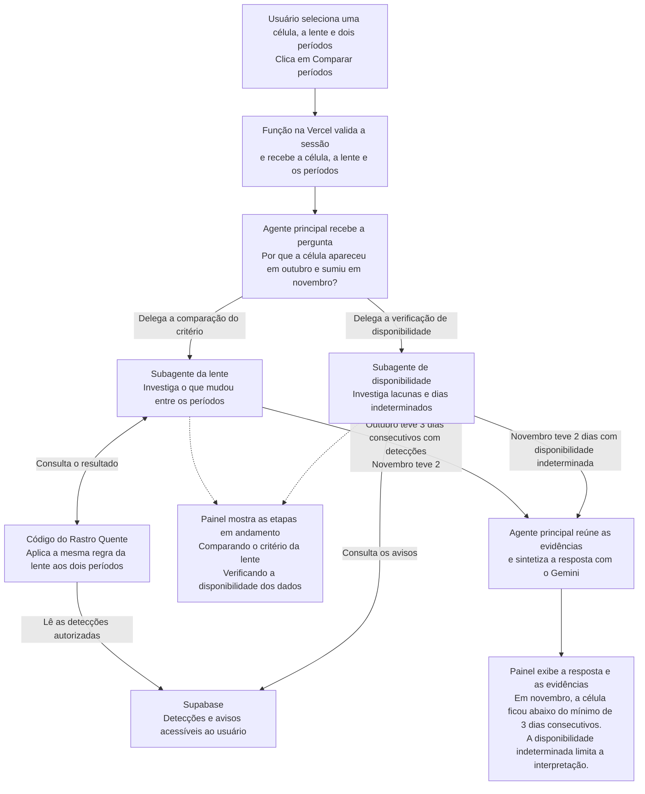

# Backlog de possibilidades

Política: `_project/README.md` › `Backlog de possibilidades`.

## BL-001 — Contrato de lente de seleção e lentes com dados já carregados

> **Criado em:** `2026-11-10`
> **Atualizado em:** `2026-11-11`
> **Estado:** `Encaminhado`

### Problema e benefício esperado

O sistema consulta detecções, mas não seleciona áreas de forma explicável. Definir um contrato único de critério (áreas ou pontos destacados, motivo e evidência) e as lentes independentes que usam dados já carregados: concentração, recorrência, persistência no mesmo ponto e cobertura confiável. Benefício: seleção explicável, com cada critério avaliável isoladamente.

### Contexto

Todas as lentes devolvem a mesma estrutura, para que a combinação futura seja uma operação sobre os resultados (interseção ou união). Os limiares de cada critério são decisões analíticas do responsável, tomadas com alternativas e exemplos numéricos antes do plano. Resultados orientam a avaliação técnica e não comprovam incêndio, dano, autoria ou infração. Exige interface mínima para escolher o critério e mostrar motivo e evidência.

### Encaminhamentos

- ciclo 004 — 2026-11-11 — item inteiro

### Restante

—

### Registro

- 2026-11-10 — Pedido explícito de guardar a necessidade; captura local.
- 2026-11-11 — Retorno da seleção no ciclo 004, com encerramento integrado em main (PR #39); estado alterado para Encaminhado.

## BL-002 — Áreas protegidas reais: fontes, camada e lentes de sobreposição e proximidade

> **Criado em:** `2026-11-10`
> **Atualizado em:** `2026-11-10`
> **Estado:** `Disponível`

### Problema e benefício esperado

Falta contexto territorial de proteção para explicar a seleção. Pesquisar fontes públicas de unidades de conservação e terras indígenas, com proveniência e condições de uso conferidas, e oferecer a camada no mapa e as lentes de sobreposição e de proximidade. Benefício: critério explicável baseado em dado oficial.

### Contexto

Disponibilidade, formato e condições de uso das fontes ainda não foram verificados. O significado de "dentro", o tratamento da borda e a distância de proximidade são decisões analíticas do responsável. A restrição de custo zero exige medir o volume das geometrias antes de aceitar a camada.

### Encaminhamentos

—

### Restante

—

### Registro

- 2026-11-10 — Pedido explícito de guardar a necessidade; captura local.

## BL-003 — Fonte auxiliar VIIRS e lente de confirmação entre satélites

> **Criado em:** `2026-11-10`
> **Atualizado em:** `2026-11-10`
> **Estado:** `Disponível`

### Problema e benefício esperado

A série principal usa um único satélite. Incluir o VIIRS como fonte auxiliar e uma lente que indique se a detecção também aparece nele. Benefício: mais confiança na seleção, com a origem de cada detecção explícita.

### Contexto

O ciclo 001 verificou que a série VIIRS do INPE concorda com o NASA FIRMS no recorte estudado. A série `AQUA_M-T` continua sendo a principal. O NASA FIRMS exige chave pessoal, que nunca é versionada. Cada fonte nova exige proveniência, condições de uso e impacto no volume conferidos.

### Encaminhamentos

—

### Restante

—

### Registro

- 2026-11-10 — Pedido explícito de guardar a necessidade; captura local.

## BL-004 — Lente de variação anual

> **Criado em:** `2026-11-10`
> **Atualizado em:** `2026-11-10`
> **Estado:** `Disponível`

### Problema e benefício esperado

Identificar onde o número de detecções subiu ou caiu em relação ao mesmo período do ano anterior. Benefício: separar áreas em crescimento de áreas com padrão sazonal estável.

### Contexto

Exige série histórica além dos 12 meses carregados, com efeito no volume e no limite de armazenamento gratuito. A comparação entre períodos depende das regras de contagem e de cobertura já adotadas.

### Encaminhamentos

—

### Restante

—

### Registro

- 2026-11-10 — Pedido explícito de guardar a necessidade; captura local.

## BL-005 — Combinação de critérios de seleção

> **Criado em:** `2026-11-10`
> **Atualizado em:** `2026-11-12`
> **Estado:** `Encaminhado`

### Problema e benefício esperado

Permitir combinar lentes já existentes por interseção ("e") ou união ("ou") sobre seus resultados. Benefício: seleções mais específicas, sem perder a explicação de qual critério destacou cada ponto.

### Contexto

Depende do contrato de lente e de mais de uma lente implementada. A combinação por pontuação com pesos é mais difícil de explicar e só entra por decisão do responsável.

### Encaminhamentos

- ciclo 005 — 2026-11-12 — item inteiro

### Restante

—

### Registro

- 2026-11-10 — Pedido explícito de guardar a necessidade; captura local.
- 2026-11-12 — Pedido explícito do responsável para registrar o retorno à fila após a integração do ciclo 005; ciclo integrado pela PR #46 em `main` (`dfa9ca8`), com o item encaminhado integralmente.

## BL-006 — CAR: fonte e lente de sobreposição

> **Criado em:** `2026-11-10`
> **Atualizado em:** `2026-11-10`
> **Estado:** `Disponível`

### Problema e benefício esperado

Cruzar as detecções com os perímetros do Cadastro Ambiental Rural, quando públicos. Benefício: acrescentar ao critério de seleção o contexto fundiário declarado.

### Contexto

O responsável considera o dado público e o cruzamento importante, e não vê impedimento de privacidade. A conferência da fonte oficial, da disponibilidade, das condições de uso e dos atributos que podem ser usados continua obrigatória pelas regras do projeto, e atributos pessoais não entram no repositório. A sobreposição não comprova infração.

### Encaminhamentos

—

### Restante

—

### Registro

- 2026-11-10 — Pedido explícito de guardar a necessidade; captura local.

## BL-007 — Definição visual e interface

> **Criado em:** `2026-11-10`
> **Atualizado em:** `2026-11-10`
> **Estado:** `Disponível`

### Problema e benefício esperado

O contrato visual não está definido. A interface atual é funcional, sem design system aprovado. Definir o estilo do produto e rever a interface, incluindo funcionalidades a discutir. Benefício: identidade e experiência coerentes com a análise.

### Contexto

Existe uma referência visual privada fora do repositório, que serve de inspiração e não de baseline. As funcionalidades a incluir ainda precisam ser discutidas. Cada lente nova pede só a interface mínima própria, sem redesenho.

### Encaminhamentos

—

### Restante

—

### Registro

- 2026-11-10 — Pedido explícito de guardar a necessidade; captura local.

## BL-008 — Atualização menos manual

> **Criado em:** `2026-11-10`
> **Atualizado em:** `2026-11-10`
> **Estado:** `Disponível`

### Problema e benefício esperado

A atualização dos dados é local, sob demanda, com janela do papel executor e aprovação administrativa do manifesto. Reduzir o esforço manual mantendo os controles de segurança e de custo zero. Benefício: dados mais atuais com menos trabalho do operador.

### Contexto

Com um único usuário, o custo da atualização manual é baixo, então a urgência depende de a frequência dos dados mudar.

### Encaminhamentos

—

### Restante

—

### Registro

- 2026-11-10 — Pedido explícito de guardar a necessidade; captura local.

## BL-009 — Explicação dos destaques das lentes no mapa

> **Criado em:** `2026-11-10`
> **Atualizado em:** `2026-11-14`
> **Estado:** `Disponível`

### Problema e benefício esperado

Permitir que o usuário entenda, no mapa, o que levou uma célula a ser destacada pelas lentes selecionadas e o que mudou quando compara dois períodos, com acesso aos critérios, às evidências e às ressalvas da análise. O usuário pode conferir o que sustenta a seleção e usar essa informação para orientar a avaliação técnica.

### Contexto

- A explicação acompanha o que está selecionado no mapa. Com uma lente, mostra o critério e as evidências. Em uma combinação, indica quais critérios contribuíram e como o operador `E` ou `OU` afetou o resultado. O contrato atual combina concentração, recorrência e persistência. A sobreposição pode ser explicada quando usada como lente individual.
- Para “Por que esta célula foi destacada?”, a interface pode apresentar o motivo, as evidências e as ressalvas que a lente já calculou. A comparação direta de dois períodos também pode ser calculada pelo código do projeto, mantendo a mesma regra, a mesma carga e os parâmetros pertinentes.
- A proposta de agentes no mapa serve para perguntas que pedem cruzamento de evidências, como “Por que esta célula apareceu em outubro e sumiu em novembro?”. Um agente principal recebe a pergunta e o recorte da tela, delega a comparação dos critérios a um subagente e a verificação de disponibilidade a outro, e sintetiza os resultados. O painel mostra etapas da execução real e permite consultar as evidências. As contagens e a aplicação dos critérios ficam a cargo do método do Rastro Quente. A explicação apoia a avaliação técnica. Detecções e sobreposições, por si só, são insuficientes para concluir que houve incêndio, dano, autoria ou infração.
- A proposta original considerava um motor local depois das lentes. Uma alternativa a avaliar é uma função na Vercel consultar o Supabase com as permissões do usuário e enviar um resumo autorizado à API Gemini. A credencial ficaria no servidor. Uso do modelo, custo, privacidade dos dados territoriais, reprodução das evidências e identificação da resposta gerada por IA são pontos a avaliar antes de qualquer plano. Essa é uma possibilidade de integração e a lógica das lentes permanece no projeto.

Exemplo fictício para demonstrar a comparação de períodos na lente de persistência.

### Encaminhamentos

—

### Restante

—

### Registro

- 2026-11-10 — Pedido explícito de guardar a necessidade; captura local.
- 2026-11-14 — Pedido explícito de registrar na fila a proposta de explicação das lentes selecionadas no mapa. O item foi detalhado com o caso de comparação entre períodos, as funções dos subagentes e o diagrama da interação.
