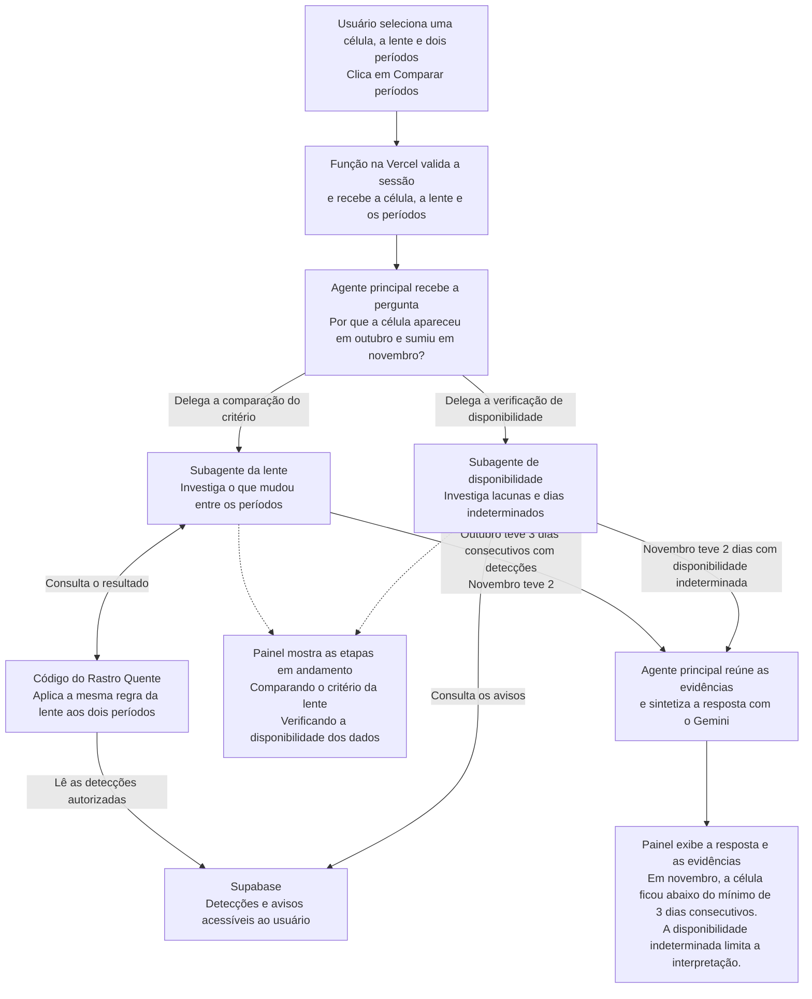

# Backlog de possibilidades

Política: `_project/README.md` › `Backlog de possibilidades`.

## BL-001 — Contrato de lente de seleção e lentes com dados já carregados

> **Criado em:** `2026-11-10`
> **Atualizado em:** `2026-11-11`
> **Estado:** `Encaminhado`

### Problema e benefício esperado

O sistema consulta detecções, mas não seleciona áreas de forma explicável. Definir um contrato único de critério (áreas ou pontos destacados, motivo e evidência) e as lentes independentes que usam dados já carregados: concentração, recorrência, persistência no mesmo ponto e cobertura confiável. Benefício: seleção explicável, com cada critério avaliável isoladamente.

### Contexto

Todas as lentes devolvem a mesma estrutura, para que a combinação futura seja uma operação sobre os resultados (interseção ou união). Os limiares de cada critério são decisões analíticas do responsável, tomadas com alternativas e exemplos numéricos antes do plano. Resultados orientam a avaliação técnica e não comprovam incêndio, dano, autoria ou infração. Exige interface mínima para escolher o critério e mostrar motivo e evidência.

### Encaminhamentos

- ciclo 004 — 2026-11-11 — item inteiro

### Restante

—

### Registro

- 2026-11-10 — Pedido explícito de guardar a necessidade; captura local.
- 2026-11-11 — Retorno da seleção no ciclo 004, com encerramento integrado em main (PR #39); estado alterado para Encaminhado.

## BL-002 — Áreas protegidas reais: fontes, camada e lentes de sobreposição e proximidade

> **Criado em:** `2026-11-10`
> **Atualizado em:** `2026-11-10`
> **Estado:** `Disponível`

### Problema e benefício esperado

Falta contexto territorial de proteção para explicar a seleção. Pesquisar fontes públicas de unidades de conservação e terras indígenas, com proveniência e condições de uso conferidas, e oferecer a camada no mapa e as lentes de sobreposição e de proximidade. Benefício: critério explicável baseado em dado oficial.

### Contexto

Disponibilidade, formato e condições de uso das fontes ainda não foram verificados. O significado de "dentro", o tratamento da borda e a distância de proximidade são decisões analíticas do responsável. A restrição de custo zero exige medir o volume das geometrias antes de aceitar a camada.

### Encaminhamentos

—

### Restante

—

### Registro

- 2026-11-10 — Pedido explícito de guardar a necessidade; captura local.

## BL-003 — Fonte auxiliar VIIRS e lente de confirmação entre satélites

> **Criado em:** `2026-11-10`
> **Atualizado em:** `2026-11-10`
> **Estado:** `Disponível`

### Problema e benefício esperado

A série principal usa um único satélite. Incluir o VIIRS como fonte auxiliar e uma lente que indique se a detecção também aparece nele. Benefício: mais confiança na seleção, com a origem de cada detecção explícita.

### Contexto

O ciclo 001 verificou que a série VIIRS do INPE concorda com o NASA FIRMS no recorte estudado. A série `AQUA_M-T` continua sendo a principal. O NASA FIRMS exige chave pessoal, que nunca é versionada. Cada fonte nova exige proveniência, condições de uso e impacto no volume conferidos.

### Encaminhamentos

—

### Restante

—

### Registro

- 2026-11-10 — Pedido explícito de guardar a necessidade; captura local.

## BL-004 — Lente de variação anual

> **Criado em:** `2026-11-10`
> **Atualizado em:** `2026-11-10`
> **Estado:** `Disponível`

### Problema e benefício esperado

Identificar onde o número de detecções subiu ou caiu em relação ao mesmo período do ano anterior. Benefício: separar áreas em crescimento de áreas com padrão sazonal estável.

### Contexto

Exige série histórica além dos 12 meses carregados, com efeito no volume e no limite de armazenamento gratuito. A comparação entre períodos depende das regras de contagem e de cobertura já adotadas.

### Encaminhamentos

—

### Restante

—

### Registro

- 2026-11-10 — Pedido explícito de guardar a necessidade; captura local.

## BL-005 — Combinação de critérios de seleção

> **Criado em:** `2026-11-10`
> **Atualizado em:** `2026-11-12`
> **Estado:** `Encaminhado`

### Problema e benefício esperado

Permitir combinar lentes já existentes por interseção ("e") ou união ("ou") sobre seus resultados. Benefício: seleções mais específicas, sem perder a explicação de qual critério destacou cada ponto.

### Contexto

Depende do contrato de lente e de mais de uma lente implementada. A combinação por pontuação com pesos é mais difícil de explicar e só entra por decisão do responsável.

### Encaminhamentos

- ciclo 005 — 2026-11-12 — item inteiro

### Restante

—

### Registro

- 2026-11-10 — Pedido explícito de guardar a necessidade; captura local.
- 2026-11-12 — Pedido explícito do responsável para registrar o retorno à fila após a integração do ciclo 005; ciclo integrado pela PR #46 em `main` (`dfa9ca8`), com o item encaminhado integralmente.

## BL-006 — CAR: fonte e lente de sobreposição

> **Criado em:** `2026-11-10`
> **Atualizado em:** `2026-11-10`
> **Estado:** `Disponível`

### Problema e benefício esperado

Cruzar as detecções com os perímetros do Cadastro Ambiental Rural, quando públicos. Benefício: acrescentar ao critério de seleção o contexto fundiário declarado.

### Contexto

O responsável considera o dado público e o cruzamento importante, e não vê impedimento de privacidade. A conferência da fonte oficial, da disponibilidade, das condições de uso e dos atributos que podem ser usados continua obrigatória pelas regras do projeto, e atributos pessoais não entram no repositório. A sobreposição não comprova infração.

### Encaminhamentos

—

### Restante

—

### Registro

- 2026-11-10 — Pedido explícito de guardar a necessidade; captura local.

## BL-007 — Definição visual e interface

> **Criado em:** `2026-11-10`
> **Atualizado em:** `2026-11-10`
> **Estado:** `Disponível`

### Problema e benefício esperado

O contrato visual não está definido. A interface atual é funcional, sem design system aprovado. Definir o estilo do produto e rever a interface, incluindo funcionalidades a discutir. Benefício: identidade e experiência coerentes com a análise.

### Contexto

Existe uma referência visual privada fora do repositório, que serve de inspiração e não de baseline. As funcionalidades a incluir ainda precisam ser discutidas. Cada lente nova pede só a interface mínima própria, sem redesenho.

### Encaminhamentos

—

### Restante

—

### Registro

- 2026-11-10 — Pedido explícito de guardar a necessidade; captura local.

## BL-008 — Atualização menos manual

> **Criado em:** `2026-11-10`
> **Atualizado em:** `2026-11-10`
> **Estado:** `Disponível`

### Problema e benefício esperado

A atualização dos dados é local, sob demanda, com janela do papel executor e aprovação administrativa do manifesto. Reduzir o esforço manual mantendo os controles de segurança e de custo zero. Benefício: dados mais atuais com menos trabalho do operador.

### Contexto

Com um único usuário, o custo da atualização manual é baixo, então a urgência depende de a frequência dos dados mudar.

### Encaminhamentos

—

### Restante

—

### Registro

- 2026-11-10 — Pedido explícito de guardar a necessidade; captura local.

## BL-009 — Explicação dos destaques das lentes no mapa

> **Criado em:** `2026-11-10`
> **Atualizado em:** `2026-11-14`
> **Estado:** `Disponível`

### Problema e benefício esperado

Permitir que o usuário entenda, no mapa, o que levou uma célula a ser destacada pelas lentes selecionadas e o que mudou quando compara dois períodos, com acesso aos critérios, às evidências e às ressalvas da análise. O usuário pode conferir o que sustenta a seleção e usar essa informação para orientar a avaliação técnica.

### Contexto

- A explicação acompanha o que está selecionado no mapa. Com uma lente, mostra o critério e as evidências. Em uma combinação, indica quais critérios contribuíram e como o operador `E` ou `OU` afetou o resultado. O contrato atual combina concentração, recorrência e persistência. A sobreposição pode ser explicada quando usada como lente individual.
- Para “Por que esta célula foi destacada?”, a interface pode apresentar o motivo, as evidências e as ressalvas que a lente já calculou. A comparação direta de dois períodos também pode ser calculada pelo código do projeto, mantendo a mesma regra, a mesma carga e os parâmetros pertinentes.
- A proposta de agentes no mapa serve para perguntas que pedem cruzamento de evidências, como “Por que esta célula apareceu em outubro e sumiu em novembro?”. Um agente principal recebe a pergunta e o recorte da tela, delega a comparação dos critérios a um subagente e a verificação de disponibilidade a outro, e sintetiza os resultados. O painel mostra etapas da execução real e permite consultar as evidências. As contagens e a aplicação dos critérios ficam a cargo do método do Rastro Quente. A explicação apoia a avaliação técnica. Detecções e sobreposições, por si só, são insuficientes para concluir que houve incêndio, dano, autoria ou infração.
- A proposta original considerava um motor local depois das lentes. Uma alternativa a avaliar é uma função na Vercel consultar o Supabase com as permissões do usuário e enviar um resumo autorizado à API Gemini. A credencial ficaria no servidor. Uso do modelo, custo, privacidade dos dados territoriais, reprodução das evidências e identificação da resposta gerada por IA são pontos a avaliar antes de qualquer plano. Essa é uma possibilidade de integração e a lógica das lentes permanece no projeto.

Exemplo fictício para demonstrar a comparação de períodos na lente de persistência.

### Encaminhamentos

—

### Restante

—

### Registro

- 2026-11-10 — Pedido explícito de guardar a necessidade; captura local.
- 2026-11-14 — Pedido explícito de registrar na fila a proposta de explicação das lentes selecionadas no mapa. O item foi detalhado com o caso de comparação entre períodos, as funções dos subagentes e o diagrama da interação.

## BL-010 — Mapa-base: travamento ao trocar de fundo e falha parcial do satélite

> **Criado em:** `2026-11-15`
> **Atualizado em:** `2026-11-15`
> **Estado:** `Encaminhado`

### Problema e benefício esperado

Depois de escolher "Sem fundo", ou depois de o satélite falhar e a tela trocar sozinha para "Sem fundo", o mapa deixa de responder: os pontos e os limites somem ao arrastar ou ao aproximar, e voltar ao "Satélite" não resolve. A atribuição da Esri também continua no mapa sem fundo. Além disso, quando só os nomes falham, o satélite inteiro é desligado, inclusive a imagem que estava carregando. Benefício: trocar de fundo com segurança e manter a imagem sempre que ela estiver disponível.

### Contexto

- Origem: uso em produção logo após a integração da issue #64 (ADR-010).
- O diagnóstico local apontou a remoção das camadas de fundo, que desligava também os ouvintes internos do Leaflet usados na própria remoção. Restam eventos de camadas já removidas, que geram erro no zoom. Uma correção pequena em `src/mapa.ts` foi esboçada e testada localmente, sem versionar.
- Manter a imagem quando só os nomes falham muda a regra de falhas do ADR-010 e exige decisão.
- A falha do satélite observada em produção vinha de um redirecionamento do login para outro domínio, fora da restrição da chave, e foi resolvida na configuração da autenticação. Não faz parte deste item.

### Encaminhamentos

- issue #71 — 2026-11-15 — Integral

### Restante

—

### Registro

- 2026-11-15 — Pedido explícito de guardar no backlog o pacote de correções do mapa discutido após a issue #64; captura local.
- 2026-11-15 — Retorno da seleção na issue #71 após integração da PR #72 em main (commit ebede5e); item integral encaminhado.

## BL-011 — Layout do mapa e da página: legenda coberta e espaço depois do rodapé

> **Criado em:** `2026-11-15`
> **Atualizado em:** `2026-11-15`
> **Estado:** `Encaminhado`

### Problema e benefício esperado

Com o satélite ligado, a atribuição longa do mapa-base ocupa a parte de baixo do mapa e cobre o botão e o painel da "Legenda". Em toda a tela de análise, com ou sem satélite, a página ganha um espaço vazio depois do rodapé. Benefício: legenda sempre legível e página com a altura da tela.

### Contexto

- O espaço extra vem dos textos só para leitor de tela da série "Detecções no período" (desde a issue #62). Eles escapam da área com rolagem embaixo do mapa.
- Correções de CSS foram esboçadas e testadas localmente, sem versionar: atribuição só do lado direito, legenda aberta por cima dela e área com rolagem como bloco de contenção. A largura da atribuição ainda precisa de ajuste em mapas estreitos.

### Encaminhamentos

- issue #71 — 2026-11-15 — Integral

### Restante

—

### Registro

- 2026-11-15 — Pedido explícito de guardar no backlog o pacote de correções do mapa discutido após a issue #64; captura local.
- 2026-11-15 — Retorno da seleção na issue #71 após integração da PR #72 em main (commit ebede5e); item integral encaminhado.

## BL-012 — Legenda do mapa com tudo o que aparece no mapa

> **Criado em:** `2026-11-15`
> **Atualizado em:** `2026-11-15`
> **Estado:** `Encaminhado`

### Problema e benefício esperado

A legenda do mapa não inclui as classes de áreas protegidas (proteção integral, uso sustentável e terra indígena) quando a camada de contexto territorial está ligada; a legenda dessas classes aparece separada, abaixo do mapa. Regra pedida: todo elemento ou análise desenhado no mapa deve constar na legenda do mapa. Benefício: leitura do mapa sem procurar explicações fora dele.

### Contexto

A referência visual V13 traz as áreas na legenda do mapa. Cada classe já tem cor, traço e hachura próprios, então a amostra na legenda não depende só da cor.

### Encaminhamentos

- issue #71 — 2026-11-15 — Integral (áreas protegidas)

### Restante

—

### Registro

- 2026-11-15 — Pedido explícito de guardar no backlog o pacote de correções do mapa discutido após a issue #64; captura local.
- 2026-11-15 — Retorno da seleção na issue #71 após integração da PR #72 em main (commit ebede5e); item integral encaminhado.

## BL-013 — Controles do mapa: mapa ampliado na altura da tela e botões no estilo de "Camadas"

> **Criado em:** `2026-11-15`
> **Atualizado em:** `2026-11-15`
> **Estado:** `Encaminhado`

### Problema e benefício esperado

O mapa ampliado ocupa a largura da tela, mas não a altura. "Enquadrar os dados" e "Lista de focos" destoam do botão "Camadas", que é compacto e discreto. Benefício: mais área útil de mapa e controles com aparência coerente.

### Contexto

Muda o contrato visual (`DESIGN.md`). Os botões devem manter a área de toque e o funcionamento em telas estreitas, que já são conferidos pelos testes de acessibilidade.

### Encaminhamentos

- issue #71 — 2026-11-15 — Integral

### Restante

—

### Registro

- 2026-11-15 — Pedido explícito de guardar no backlog o pacote de correções do mapa discutido após a issue #64; captura local.
- 2026-11-15 — Retorno da seleção na issue #71 após integração da PR #72 em main (commit ebede5e); item integral encaminhado.

## BL-014 — Tela de acesso mais enxuta

> **Criado em:** `2026-11-15`
> **Atualizado em:** `2026-11-15`
> **Estado:** `Encaminhado`

### Problema e benefício esperado

A tela de acesso mostra textos que não ajudam a entrar: o aviso em destaque sobre a consulta de detecções do satélite AQUA_M-T/INPE em Mato Grosso, com a ressalva sobre detecções e sobreposições, e o rodapé de ressalvas. O botão "Entrar com o Google" não está centralizado na caixa de acesso. Pedido: retirar o aviso e o rodapé dessa tela e centralizar o botão. Benefício: entrada mais limpa e direta.

### Contexto

As ressalvas continuam na tela de análise, depois de entrar.

### Encaminhamentos

- issue #71 — 2026-11-15 — Integral

### Restante

—

### Registro

- 2026-11-15 — Pedido explícito de guardar no backlog ajustes da tela de acesso; captura local.
- 2026-11-15 — Retorno da seleção na issue #71 após integração da PR #72 em main (commit ebede5e); item integral encaminhado.

## BL-015 — Painel de filtros: resumo do filtro recolhido, cor de seleção e aviso desatualizado

> **Criado em:** `2026-11-15`
> **Atualizado em:** `2026-11-15`
> **Estado:** `Encaminhado`

### Problema e benefício esperado

- Ao recolher o filtro "Consulta", aparecem o município e o período. Os demais filtros recolhidos não mostram nada; pedido: seguir o mesmo padrão.
- Clicar em qualquer parte do painel de filtros mostra um preenchimento azul que chama atenção e foge do padrão visual. Pedido: trocar por uma cor coerente com a interface, por exemplo o verde já usado, em todo o painel de filtros e em todos os lugares onde esse azul aparece com a mesma função.
- Abaixo do filtro de município continua o aviso "As lentes ainda usam todo Mato Grosso", desatualizado desde que as lentes passaram a usar o recorte da consulta (issue #63).

Benefício: painel discreto, consistente e sem informação errada.

### Contexto

O azul claro também marca a seleção no mapa (tracejado azul claro); essa marca faz parte do contrato visual (`DESIGN.md`) e da legenda. Falta decidir se a troca de cor alcança a seleção no mapa ou só os controles da interface. A troca deve manter o contraste e o indicador de foco visível.

### Encaminhamentos

- issue #71 — 2026-11-15 — Integral (cor só na interface)

### Restante

—

### Registro

- 2026-11-15 — Pedido explícito de guardar no backlog ajustes do painel de filtros e o aviso desatualizado observado após a issue #63; captura local.
- 2026-11-15 — Retorno da seleção na issue #71 após integração da PR #72 em main (commit ebede5e); item integral encaminhado.

## BL-016 — Barras proporcionais na lista de municípios

> **Criado em:** `2026-11-15`
> **Atualizado em:** `2026-11-15`
> **Estado:** `Encaminhado`

### Problema e benefício esperado

Na aba "Municípios" do painel de resultado, cada município tem uma faixa laranja do mesmo tamanho, seja qual for o número: um município com 1 detecção e outro com 901 ficam iguais, e a faixa não diferencia nada. Pedido: a faixa deve ser proporcional ao valor mostrado, tanto na ordenação por detecções quanto na ordenação por destaques da lente. Benefício: comparação visual imediata entre municípios.

### Contexto

A ordem e o tamanho da faixa não indicam prioridade, gravidade nem risco, como a própria lista já avisa. A faixa continua acompanhada do número.

### Encaminhamentos

- issue #71 — 2026-11-15 — Integral

### Restante

—

### Registro

- 2026-11-15 — Pedido explícito de guardar no backlog o ajuste da lista de municípios; captura local.
- 2026-11-15 — Retorno da seleção na issue #71 após integração da PR #72 em main (commit ebede5e); item integral encaminhado.

## BL-017 — Rótulos das lentes e espaço do mapa

> **Criado em:** `2026-11-15`
> **Atualizado em:** `2026-11-15`
> **Estado:** `Disponível`

### Problema e benefício esperado

A relação entre as opções de lentes à esquerda e os resultados à direita não fica evidente, e os cartões de resumo abaixo do mapa ocupam espaço que não ajuda a leitura. Clarificar a identificação das lentes e liberar espaço para o mapa, preservando a série temporal e a Lista de focos. Benefício: reconhecer qual lente produz cada resultado e ter mais área de mapa sem dificultar o acesso à lista de detecções.

### Contexto

- Na coluna esquerda, acrescentar o rótulo **Lentes** antes das opções existentes e mudar somente **Lente de seleção** para **Seleção**. Manter **Contexto territorial** e **Cruzar critérios** como estão; os controles e seus comportamentos permanecem.
- Na coluna direita, mudar a aba **Destaques** para **Lentes**. Dentro dela, o título do resultado identifica a opção ativa — **Concentração**, **Recorrência**, **Persistência**, **Sobreposição com áreas protegidas** ou **Combinação de lentes** — no lugar de títulos genéricos como “Células destacadas” ou “Municípios destacados”. As listas e explicações existentes permanecem.
- Abaixo do mapa, retirar **No mapa**, **Detecções no período (dias GMT)** e **Disponibilidade dos dados**, incluindo seu detalhamento de classes, histórico, dias e motivos. Manter somente a série temporal em barras, vinculada ao período aplicado na consulta. A Lista de focos permanece inalterada.
- Usar parte do espaço liberado para aumentar moderadamente a altura do mapa, com limite para que a Lista de focos continue visível e acessível quando aberta.
- Preservar **Como ler esta tela** como visão geral de alto nível, no formato atual; atualizar somente referências que fiquem desatualizadas, sem transformá-lo em manual.
- Não alterar os métodos, cálculos ou critérios das lentes.

### Encaminhamentos

—

### Restante

—

### Registro

- 2026-11-15 — Pedido explícito de guardar em um único item as mudanças de identificação das lentes, simplificação da área do mapa e atualização pontual de “Como ler esta tela”; captura local.
