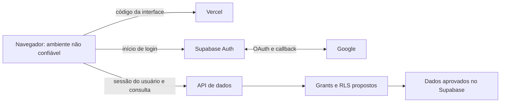
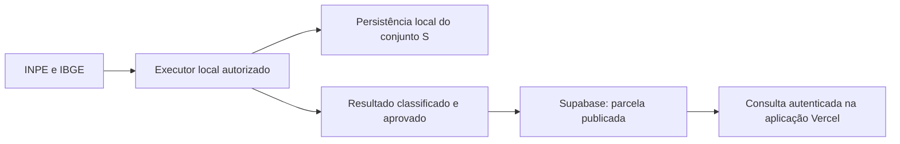
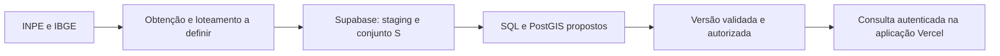
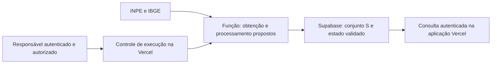

# Avaliação documental de focos e limites IBGE, sem camadas adicionais de sobreposição; duração e consumo de processamento indeterminados

> **Ciclo:** `002` · **Item:** `3` · **Issue:** [#14](https://github.com/EuThiagoAndrade/rastro-quente/issues/14)
> **Data:** 2026-11-05
> **Base integrada:** `2cb40044bd42edefac94cbd1d360dd8ebcd9f67d`, após PRs #15 e #16.
> **Natureza:** comparação e matriz de acesso propostas; nenhuma arquitetura aceita, infraestrutura criada ou prova executada.

**Parecer: evidência insuficiente para as três alternativas nos 27 cenários.** Existem incompatibilidades demonstradas para caminhos específicos de ingestão, não uma prova de que todos os caminhos de uma alternativa falhem. Demanda estadual de até dois anos, processamento, acesso implementado, recuperação e elegibilidade de conta continuam materiais e não verificados. Não há recomendação de fundação operacional ou garantia de custo zero.

Focos e sobreposições não comprovam incêndio, dano, autoria ou infração. O recorte exclui outras camadas e a seleção de áreas. Vercel, Supabase e login Google permanecem requisitos; mudar o executor não remove nenhum deles.

## 1. Evidências, hipóteses e regra de conclusão

- **E1:** [Cenários](002_research_cenarios.md), seções 3–8: entradas, unidades, armazenamento por destino, arestas de tráfego e lacunas LAC-01 a LAC-10.
- **E2:** [Capacidades e custos](002_research_capacidades_custos.md), seções 2–8 e índice de fontes: cotas/condições datadas de 2026-11-05, incompatibilidades de rotas e lacunas CUS-01 a CUS-06. IDs `V*`, `P*`, `G*`, `A*` abaixo remetem à seção 9 de E2. Os dois documentos estão fixados pela base acima e permanecem sem alteração.
- **E3:** plano v2 aprovado, ADR-002/003 e KB-003. A prova do ciclo 001 demonstra somente seu recorte municipal; não estima MT, dois anos, capacidade ou método de seleção.
- **N1–N8:** documentação oficial relida nesta entrega, com URLs/seções na seção 9. Complementa a análise de acesso e execução; não revalida uma conta ou todas as 32 fontes de E2.

As arquiteturas e políticas deste relatório são **hipóteses/propostas**, não requisitos operacionais aprovados. Não foram lidos `local/`, dados de contas ou brutos. Nenhum teste de login, RLS, carga, expurgo ou recuperação foi executado.

| Hipótese persistida | Definição | Quantificação ausente |
| :-- | :-- | :-- |
| S1 | `AQUA_M-T` | `N1`, bytes e consumo por operação na janela estadual |
| S2 | S1 + `NPP-375`, `NPP-375D`, `NOAA-20`, `NOAA-21`, mantendo séries distintas | `N2` e demanda própria, sem multiplicar S1 por razão municipal |
| S3 | Todos os valores presentes nas fontes/versões da janela | `N3`, universo por versão e demanda própria; não equivale a S2 |

Mantêm-se E/W/D (`U = 1/5/31`) e Q20/Q200/Q2000, hipóteses independentes de um mês de 31 dias, um usuário e MT. A janela é variável e limitada a dois anos de calendário. Nenhuma frequência, conjunto ou prazo foi escolhido. Cada combinação é avaliada no mês inicial e no mês comum.

Por recurso: **C** = cabe documentalmente com demanda e condição correspondentes; **E** = excede/viola condição demonstrada; **I** = indeterminado; **NA** somente com justificativa no fluxo. Por alternativa/cenário/conjunto, aplicar nesta ordem:

1. Requisito necessário com resultado E → **incompatível no cenário avaliado**, identificando o requisito.
2. Sem E comprovado, mas com qualquer I material → **evidência insuficiente**.
3. Somente com todos os recursos materiais documentados e atendidos → **candidata documentalmente compatível**, sem equivaler a desempenho testado.

O resultado é da composição dos recursos, não de uma votação. Compatibilidade isolada de MAU ou armazenamento não compensa CPU, recuperação ou autorização desconhecidas. A lista de recursos materiais da seção 4 antecede a síntese da seção 6.

## 2. Fluxo de consulta e fronteiras comuns

Desenho candidato comum: Vercel entrega a interface; Google autentica por meio de Supabase Auth; consultas chegam ao Supabase com a sessão do usuário e passam por autorização. Isso não pressupõe que login restrinja sozinho o aplicativo ao responsável.

O diagrama descreve fluxo lógico, não um deploy ou redirecionamento HTTP detalhado. Fronteiras: dispositivo/navegador, infraestrutura Vercel, Supabase e Google são domínios distintos de controle; fontes públicas também são entradas externas a validar. Cada passagem tem autenticação/autorização, volume de transferência e falha próprios.

Uma interface estática com chamadas autenticadas é suficiente como hipótese de comparação; não se escolhe framework. SSR/backend intermediário acrescentaria execução, tráfego e gestão de sessão na Vercel. Se usado, respostas com sessão não podem ser compartilhadas em cache e clientes de sessão não devem ser reutilizados entre usuários; documentação alerta para esses vazamentos [N3]. Nenhum ganho de cache é contabilizado sem demonstrar que o conteúdo é apropriado para compartilhamento.

## 3. Alternativas e ciclo de dados

### A1 — processamento local sob demanda, publicação futura de resultados mínimos

**Persistência:** todos os registros do conjunto S escolhido para a hipótese continuam contabilizados localmente (`Local_s` de E1). A parcela publicada tem tamanho independente `Pub_s`, desconhecido; não se presume `Pub_s` pequeno ou igual a `N_s`. S1, S2 e S3 continuam hipóteses separadas de persistência completa, sem descartar VIIRS ou satélites para caber na nuvem. Se consultas exigirem registros ausentes do resultado publicado, o contrato de consultas estará incompleto; não assumir que a máquina local estará disponível para servi-los.

**Carga, atualização e expiração:** responsável autoriza a execução local; executor obtém fontes com proveniência, valida recorte/versão, produz resultado e só então publica a versão aprovada. Correções e repetição da mesma publicação exigem idempotência a especificar. Expirar dados locais e publicados conforme janela não elimina automaticamente versões, cópias e temporários. Não há importador ou forma de publicação implementada.

**Confiança e falhas:** credencial de escrita fica no ambiente controlado do executor, nunca no bundle ou arquivo distribuído. Publicação não pode expor conteúdo antes de classificado. Falta de energia/rede, máquina indisponível, publicação parcial ou credencial inválida deixam a atualização incompleta; proposta é conservar a última versão íntegra e informar sua data, sem inventar dado recente.

**Recuperação e custos:** cópias locais, integridade, restauração da parcela publicada e tempo do operador são necessários e não dimensionados. Node existente não garante engine geoespacial, RAM, disco, energia ou internet gratuitos. Engine/biblioteca adicional e protocolo de publicação requerem escolha/verificação posterior. Vercel/Supabase/Google continuam no percurso da aplicação. Menos processamento geoespacial hospedado só seria uma vantagem comprovada após conhecer `Pub_s`, consultas e recursos locais.

### A2 — processamento no Supabase/PostGIS, em lotes

**Persistência:** `N_s` e a malha ficam no banco, com índices, geometrias, agregados, staging e WAL contabilizados separadamente. PostGIS é suporte documentado, não método ou desempenho aprovado. A documentação recomenda schema dedicado para a extensão [N8]; não criar objetos em `public` por cópia de exemplo. Toda futura tabela `public` continua sujeita a RLS local.

**Carga e execução:** o componente que obtém/loteia os CSV ainda é dependência material; não se presume download HTTP nativo pelo PostgreSQL. Poderia ser processo local autorizado apenas de aquisição, tornando o fluxo híbrido; isso não foi escolhido nem elimina seus custos. Lotes seriam processados por transações/SQL com identidade e permissões delimitadas. Timeout de consulta, conexões, memória e concorrência precisam ser conferidos no caminho efetivo; o limite de uma Edge Function não é o de SQL [E2/P10/P11; N6].

**Atualização, expiração e falhas:** uma versão parcial não deve substituir a última íntegra; repetição, correção da fonte, transição de versão e expurgo exigem contrato posterior. Falha de transação, pausa ou banco somente leitura pode interromper lotes; retries devem preservar integridade e ser contados em requests/CPU/WAL. Aumentar timeout ou executar como administrador não demonstra suficiência nem autorização.

**Recuperação e custos:** cópia de banco e objetos, reindexação, restauração e retomada após inatividade precisam de prova. Banco lógico de 500 MB sob leituras divergentes, disco fixo de 2 GB, CPU compartilhada e egress podem ser limitantes; demanda não quantificada mantém I [E2/P1–P3/P9/P15]. Edge Functions seriam dependência opcional adicional, não requisito gratuito implícito. Não usar branching Pro, PITR ou saldo temporário para declarar custo zero.

### A3 — funções Vercel para processamento, persistência no Supabase

**Persistência e execução:** dados de S1/S2/S3 continuam no Supabase com a demanda completa `DB_s`; função não é banco ou cópia de recuperação. Runtime e biblioteca geoespacial não foram escolhidos. Processamento deve caber por execução e no agregado: para Fluid Compute Hobby, 300 s, 2 GB/1 vCPU e franquias de 4 CPU-h, 360 GB-h e um milhão de invocações são limites documentais, não medições do projeto [E2/V1/V4; N5].

**Carga e controle:** um pedido autorizado dispara a operação; identidade do solicitante e privilégio do executor têm de ser separados. Servir um endpoint com segredo administrativo sem autorização permitiria um desvio de RLS. A função poderia obter a fonte diretamente; isso não equivale a receber o CSV inteiro no body de entrada. Fragmentação, stream, checkpoints e retomada não foram implementados nem certificados. Se precisasse de fila, scheduler ou executor diferente, isso seria dependência adicional a verificar, sem presumir gratuidade.

**Atualização, expiração e falhas:** timeout, cancelamento, retry ou sucesso no banco com falha de resposta não podem duplicar publicação ou misturar versões. Proposta é expor somente versão íntegra com proveniência e estado de atualização; como demonstrá-lo pertence à prova futura. Expurgo também consome função/banco e pode gerar WAL. O período de retenção não limita automaticamente essas cópias.

**Recuperação e custos:** repetir função não substitui backup. Recuperação depende de cópias do Supabase, fontes/versões e eventual armazenamento externo, além de reprocessamento dentro das cotas. Egress banco → função → navegador pode consumir métricas em ambos os provedores. Plano Hobby, elegibilidade não comercial, Google, ambientes e observabilidade continuam condicionantes, mesmo com pouco processamento.

### Comparação de dependências, sem adoção

| Aspecto | A1 — local | A2 — Supabase | A3 — Vercel |
| :-- | :-- | :-- | :-- |
| Executor geoespacial | Máquina/engine local a definir | SQL/PostGIS, versão/configuração a verificar | Runtime e biblioteca compatível a definir |
| Obtenção das fontes | Local, com rede e disco necessários | Loteador externo a definir, possivelmente local | Fetch da função como hipótese, com limites de duração/memória/rede |
| Framework | Interface estática candidata; SDK/build/licença a conferir na fundação | Igual; RPC/acesso direto não escolhe SSR | Igual para interface; runtime do processamento não impõe framework |
| Ambientes | Local + aplicação/banco; capacidade e separação NV | Banco de teste/produção e obtenção; vagas/isolamento NV | Funções preview/produção + banco; preview não cria isolamento de dados |
| Dados completos do conjunto | Local; publicação `Pub_s` ainda sem contrato | Banco Supabase | Banco Supabase |
| Dependências ainda sem custo/licença fechados | Engine, hardware, operação, cópias | Loteador, ferramentas, cópias | Biblioteca, eventual coordenação de tarefas, cópias |

Nenhuma exige por inferência tiles, mapas de terceiros, geocodificação, SMTP/SMS próprio, domínio pago, Workflows ou nova camada. Se forem necessários ao fluxo futuro, verificar uso/licença/cota antes de considerar compatibilidade. Licenças Node/PostGIS estão em E2/A1/A2; não autorizam automaticamente outra biblioteca ou ferramenta local, nem eliminam custo de operação.

## 4. Recursos materiais antes da síntese

**Todos os itens abaixo são materiais. I significa demanda/condição indeterminada no fluxo, não zero.** Cotas e ressalvas vêm de E2, com a regra conservadora de banco por projeto **e** soma organizacional até esclarecer a divergência. Unidades de MB/GB não certificadas continuam sem conversão em margem real.

| Recurso | A1 | A2 | A3 | Ligação à evidência e consequência |
| :-- | :-- | :-- | :-- | :-- |
| R01 — dados persistidos, limites, índices e agregados | I: conjunto completo local + `Pub_s` na nuvem | I: `DB_s` completo | I: `DB_s` completo | E1/3–6; E2/3.2: banco 500 MB com divergência de escopo; não extrapolar Colniza |
| R02 — pico de disco, staging, temporários e WAL | I: picos locais e de publicação | I: lotes, índices e WAL | I: execução e escrita no banco | E1/6.1; E2/P3: disco do banco 2 GB e proteção próxima de 95%, sem garantia de evitar lotação |
| R03 — brutos, objetos, exportações e cópias | I: bytes/retenção/destinos | I: se houver objetos e exportações | I: se houver objetos e exportações | E2/P4/P7/P15: 1 GB de objetos, média/GB-h, 50 MB por arquivo; backup de banco não inclui objetos |
| R04 — rede e egress por aresta | I: fonte/local, publicação e consulta | I: fonte/loteador, banco e consulta | I: fonte/função, banco/função/navegador | E1/6.2; E2/P9/V1: 5 GB uncached e 5 cached separados; Vercel 100 GB Data/10 GB Origin, sem juntar saldos |
| R05 — requests, consultas e sessões | I: Q não determina páginas/requests | I: mesmas incógnitas + loteador | I: mesmas incógnitas + invocações/retries | E2/5.1: franquias distintas; API de banco sem cota numérica de quantidade não oferece CPU ilimitada |
| R06 — CPU, memória, I/O e duração | I: capacidade local/prioridades NV | I: SQL/índices/conexões NV | I: runtime/instâncias NV | E1/6.3; E2/V1/V4/P10/P11: CPU-s, parede e GB-h não se substituem |
| R07 — autenticação, autorização e segredos | I: publicação e consulta precisam da matriz | I: RLS/RPC e executor precisam da matriz | I: controle, função e consulta precisam da matriz | E2/G1–G3; seção 5 abaixo: suporte Google não comprova acesso exclusivo ou conta elegível |
| R08 — disponibilidade, expurgo, falha e recuperação | I: operador, cópias e atualização NV | I: pausa, restore e objetivos NV | I: timeout/retry, banco e objetivos NV | E2/P14/P15/P17: Free pode pausar; não há RPO/RTO aprovados ou restore testado |
| R09 — ambientes, região, observabilidade e dependências | I: ferramentas/isolamento NV | I: testes/produção e loteador NV | I: previews/produção e banco NV | E2/P8/V6/V8/P1: branching pago, duas vagas Free condicionais, logs limitados; região e cache não verificados |
| R10 — elegibilidade e custo de ponta a ponta | I: inclusive hardware/energia/operador | I: inclusive obtenção/cópias | I: inclusive coordenação/cópias | E2/2–4, CUS-01–06: modalidades, cadastro, Google, billing e dependências ainda NV |

A1 não usa funções Vercel para **processar geometrias** na hipótese base: essa parcela específica é NA, mas entrega da aplicação e eventual backend de sessão ainda têm recursos materiais. A1 não zera o custo do processamento: ele passa a R06 local. A2 não exige Edge Functions na hipótese base: seus limites são NA só enquanto nenhum passo depender delas; CPU/SQL permanecem R06. A3 não usa processamento local geoespacial na hipótese base, mas desenvolvimento, publicação e eventual recuperação local continuam dependências a definir. Nenhuma omissão de executor produz compatibilidade automática.

## 5. Matriz conceitual de acesso e segredos

**Proposta para revisão na fundação, sem tabelas, políticas ou identidades criadas.** Papéis de teste: AN (anônimo), RP (responsável autenticado **e autorizado**), OA (outro autenticado não autorizado) e EX (processo privilegiado futuro, controlado e limitado à operação). RP não significa qualquer conta Google nem qualquer membro do papel técnico `authenticated`.

| Recurso/ação proposta | AN | RP | OA | EX |
| :-- | :-- | :-- | :-- | :-- |
| Interface sem dados e início de login | Permitir | Permitir | Permitir login; não dados | NA: não é usuário de interface |
| Ler focos/limites e proveniência sanitizada já classificados/aprovados para o protótipo | Negar | Permitir leitura pelo escopo aprovado | Negar | Somente leitura necessária à operação autorizada |
| Criar/corrigir/expirar registros publicados | Negar | Negar escrita direta; pode solicitar operação prevista | Negar | Permitir somente operação e recorte aprovados, com validação de entrada |
| Solicitar atualização | Negar | Permitir solicitação delimitada | Negar | Não aceitar solicitação arbitrária como autorização; executar somente comando validado |
| Ler estado do processamento/erros sanitizados | Negar | Permitir | Negar | Ler/gravar o estado da própria operação, sem segredos |
| Ler exportação sanitizada aprovada | Negar | Permitir conforme escopo | Negar | Produzir somente se a operação tiver essa permissão |
| Dados restritos ou de classificação desconhecida | Negar | Negar exposição/consulta pela aplicação até classificação/autorização próprias | Negar | Negar ingestão/publicação nesta hipótese; classificação desconhecida não é permissão |
| Alterar autorização, papel ou configuração de segurança | Negar | Negar pela aplicação comum | Negar | Negar ao executor de dados; administração é ação separada |
| Obter segredos administrativos/OAuth ou backups com credenciais | Negar | Negar pelo navegador/interface | Negar | Só segredo necessário no ambiente controlado; sem exportá-lo em resultado/log |

Dados territoriais potencialmente compartilháveis não viram dados de propriedade pessoal por herdar `user_id` de outro produto. A proposta distingue autorização do responsável para consultar o conjunto compartilhado e eventual isolamento de preferências privadas futuras; nenhuma tabela, proprietário ou schema semântico é escolhido. Público na fonte não equivale a publicação irrestrita dos resultados no aplicativo. Classificação desconhecida impede exposição inclusive em bundle, bucket público, preview ou log.

### Mecanismos e limites a demonstrar

- **RLS e grants:** toda futura tabela `public` terá RLS pela regra local; privilégios de tabela, políticas de leitura e `WITH CHECK` de escrita deverão realizar a matriz, também em chamadas diretas ao banco/API. Ocultar botão ou validar só a página não satisfaz G2. Views, RPC e objetos de Storage exigem revisão própria [N1, N2, N4].
- **Identidade versus acesso:** o servidor deve verificar a sessão e a autorização vinculada a identidade confiável; dado editável pelo próprio cliente não pode promovê-lo a RP/EX. As duas contas de teste autenticadas precisam produzir resultados diferentes mesmo sob o mesmo papel técnico. Nenhum identificador real foi escolhido.
- **Privilégio:** chaves públicas identificam o componente, não autorizam o responsável. Segredos administrativos e `service_role` podem contornar RLS; separar contexto de consulta de usuário e contexto administrativo. Não confiar no comportamento do cliente inicializado com segredo para preservar escopo do usuário [N1, N2].
- **Funções:** preferir `security invoker` na hipótese; qualquer necessidade de `security definer` exige justificação, revisão de `search_path`, grants de execução e autorização explícita no corpo. Uma função privilegiada pode devolver dados que o chamador não leria por RLS [N4]. Não há função SQL proposta como implementação nesta entrega.
- **Storage e cache:** revisar listagem/leitura/escrita separadamente, sem tornar bucket público como atalho. URLs temporárias, se escolhidas, precisam de controle de emissão e risco de repasse. Respostas com dados/sessão e clientes SSR não podem vazar entre RP/OA [N3, N7]. Nenhuma URL ou sessão foi emitida.

| Material | Local candidato, sujeito à fundação | Limite |
| :-- | :-- | :-- |
| Chave publicável e identificação pública da aplicação | Cliente, se a API for usada assim | Pode ser observada; não substitui sessão, grants ou RLS [N2] |
| Token de sessão do usuário | Contexto do usuário, tratado como credencial | Não versionar, logar ou compartilhar em cache; formato/armazenamento/refresh a definir e testar |
| Segredo OAuth Google | Configuração controlada do provedor/backend | Não entra no bundle ou variável pública |
| Segredo de ingestão/credencial de banco | Executor local controlado (A1/loteador) ou backend (A2/A3), com privilégio delimitado | Não colocar em arquivo distribuído, repositório, entrada arbitrária do cliente ou log; mecanismo de guarda/rotação ainda NV |

O desenho não torna uma chave administrativa de acesso amplo restrita por declaração: se o mecanismo conceder bypass, os limites dependem de código, grants, isolamento do executor e operação controlada. Isso é risco residual material, sem isolamento comprovado. Se privilégios mínimos não puderem ser implementados, o fluxo deverá ser rejeitado ou revisto em escopo autorizado.

## 6. Resultado por alternativa, cenário e conjunto

**EI = evidência insuficiente**, porque R01–R10 têm incógnitas materiais nas três alternativas. As colunas são conclusões distintas para A1/A2/A3, não uma escolha conjunta de executor. A análise aplica-se ao mês inicial e ao mês comum; nenhum deles tem duração/consumo medidos.

| Cenário | Conjunto | U | Q | A1 — local | A2 — Supabase | A3 — Vercel |
| :-- | :-- | --: | --: | :-- | :-- | :-- |
| E-Q20 | S1 | 1 | 20 | EI | EI | EI |
| E-Q20 | S2 | 1 | 20 | EI | EI | EI |
| E-Q20 | S3 | 1 | 20 | EI | EI | EI |
| E-Q200 | S1 | 1 | 200 | EI | EI | EI |
| E-Q200 | S2 | 1 | 200 | EI | EI | EI |
| E-Q200 | S3 | 1 | 200 | EI | EI | EI |
| E-Q2000 | S1 | 1 | 2.000 | EI | EI | EI |
| E-Q2000 | S2 | 1 | 2.000 | EI | EI | EI |
| E-Q2000 | S3 | 1 | 2.000 | EI | EI | EI |
| W-Q20 | S1 | 5 | 20 | EI | EI | EI |
| W-Q20 | S2 | 5 | 20 | EI | EI | EI |
| W-Q20 | S3 | 5 | 20 | EI | EI | EI |
| W-Q200 | S1 | 5 | 200 | EI | EI | EI |
| W-Q200 | S2 | 5 | 200 | EI | EI | EI |
| W-Q200 | S3 | 5 | 200 | EI | EI | EI |
| W-Q2000 | S1 | 5 | 2.000 | EI | EI | EI |
| W-Q2000 | S2 | 5 | 2.000 | EI | EI | EI |
| W-Q2000 | S3 | 5 | 2.000 | EI | EI | EI |
| D-Q20 | S1 | 31 | 20 | EI | EI | EI |
| D-Q20 | S2 | 31 | 20 | EI | EI | EI |
| D-Q20 | S3 | 31 | 20 | EI | EI | EI |
| D-Q200 | S1 | 31 | 200 | EI | EI | EI |
| D-Q200 | S2 | 31 | 200 | EI | EI | EI |
| D-Q200 | S3 | 31 | 200 | EI | EI | EI |
| D-Q2000 | S1 | 31 | 2.000 | EI | EI | EI |
| D-Q2000 | S2 | 31 | 2.000 | EI | EI | EI |
| D-Q2000 | S3 | 31 | 2.000 | EI | EI | EI |

São **81 avaliações**: 27 combinações × três alternativas, preservando as nove combinações U/Q de cada S1/S2/S3. A repetição do veredito não torna suas demandas iguais: A1 depende de `Local_s`/`Pub_s`, A2 de banco+loteador e A3 de banco+função. Frequência multiplica consumo unitário desconhecido; número de consultas não determina tamanho de resposta. Cotas conhecidas não fornecem esses valores.

### Compatibilidades parciais e caminhos incompatíveis

O componente projetado de **um MAU** cabe condicionalmente na contagem de 50 mil MAUs em qualquer linha, somente se o cenário for de fato exclusivo e não houver consumo de outros projetos da organização [E2/P12]. Não demonstra login seguro, quota da conta ou custo completo. Não há outra compatibilidade numérica de demanda real quantificada que sustente o conjunto.

| Condição adicional ao cenário | Onde afeta | Veredito se for requisito necessário |
| :-- | :-- | :-- |
| CSVs nacionais mensais históricos integrais como objetos Storage Free | Qualquer alternativa que escolha esse caminho | Incompatível: cada arquivo tem mais de 50 MB [E2/7.1]. Não é uma medição do tamanho dos dados de MT. |
| CSV nacional mensal inteiro no body de entrada de função Vercel | A3 ou backend auxiliar de A1/A2, se esse transporte for exigido | Incompatível: excede 4,5 MB [E2/7.1; N5]. Fetch feito pela função é caminho diferente e continua sem prova de capacidade. |
| Preview branching Supabase gerenciado ou PITR pago como requisito de custo zero | As três, se dependentes dessas capacidades | Incompatível com modalidade gratuita documentada [E2/P8/P15]; não contratar para contornar. |
| Uso que não atenda à elegibilidade pessoal não comercial de Hobby | As três, pois Vercel é requisito | Incompatível se o enquadramento for confirmado [E2/V2]. Finalidade concreta ainda NV; não declarar que este projeto já viola a condição. |
| Prazo, memória ou volume comprovadamente acima da cota sem caminho válido alternativo | Executor/recurso correspondente | Incompatível quando a violação existir; ainda não comprovada para a demanda estadual. Sem demanda, mantém EI. |

Não se elimina uma alternativa inteira por incompatibilidade de uma rota opcional. Se a fundação tornar essa rota necessária, o veredito daquela alternativa/cenário passa de EI para incompatível, conforme a precedência da seção 1; uma alternativa substituta deverá ter evidência própria.

### Conferência lógica e de fronteira

Casos independentes do parecer: `[C, C]` → candidata documentalmente compatível; `[C, I]` → evidência insuficiente; `[C, E, I]` → incompatível. Esses casos verificam a precedência, sem classificar como C um recurso real desconhecido. Para CPU Vercel, 4 CPU-h = 14.400 CPU-s: 14.399/14.400/14.401 ficam abaixo/no limite/acima; igualdade não comprova margem operacional. As contas herdadas foram conferidas sem chamadas aos serviços. Não calcular margem de cenário real com as larguras fictícias de E1.

## 7. Lacunas e protocolos de provas futuras — não executados

As lacunas LAC-01–10 (E1) e CUS-01–06 (E2) permanecem como origem. Protocolos abaixo são propostas para escopo/autorização posteriores. **Nenhum comando de prova foi executado**, nenhuma conta foi criada e nenhum dado foi enviado a provedor. Fixar ambiente, ferramentas/versões/licenças, orçamento zero e objetivo antes de qualquer prova. Ferramenta local ou serviço novo necessário continua dependência, sem instalação implícita.

| Protocolo | Pergunta e dados apropriados | Ambiente e sequência sugerida | Métricas e referência independente | Critério de aceite proposto e autorização |
| :-- | :-- | :-- | :-- | :-- |
| PF1 — volume e semântica | Qual demanda de S1/S2/S3 na janela aprovada de MT? Estatísticas oficiais compatíveis; se insuficientes, fonte pública com licença/proveniência conferidas e amostra/recorte explicitamente autorizado. Fixtures fictícias para dentro/fora/borda e limites temporais. | Primeiro fixar janela, fonte/versão e regra territorial/temporal com o responsável. Depois conferir estatística ou, com autorização própria, contar o recorte e registrar hashes, bytes e critérios. Sem recontagem dos brutos locais por esta issue. | Registros por conjunto, bytes brutos, largura/tipos e casos de fronteira; estatística oficial correspondente ou segundo caminho de contagem independente do primeiro. Borda e semântica estadual precisam de resultado esperado aprovado. | Concordância exata dos casos/contagens sob o mesmo contrato ou divergência explicada antes de aceitar; nenhuma regra ambiental escolhida pelo executor. Autorizar obtenção/leitura/contagem e tratamento de dados antes de executar. Sem equivalência documental, manter insuficiência. |
| PF2 — capacidade dos três executores | Onde o mesmo trabalho cabe? Usar fixture fictícia comum e recorte público aprovado de PF1, preservando todos os conjuntos, sem representar uma amostra como escala estadual. | Ambientes isolados, local para A1 e ambientes gratuitos autorizados para A2/A3; separar obtenção, importação, operação territorial, índices, consulta e expurgo. Fixar número de repetições/cargas, runtime, região, tipos e caminho de lote. Não iniciar serviço pago ou trial. | Parede por tarefa, CPU-s, memória de pico, GB-h de instância quando aplicável, I/O, WAL, banco/índices/disco, payloads, requests e egress por aresta. Conferir saídas contra referência de PF1; não apenas comparar executores entre si. | Resultados corretos e todos os limites documentados atendidos no escopo medido; para latência/disponibilidade, responsável deve definir objetivo antes. Falta de representatividade ou recurso não medido mantém EI. Excesso/custo interrompe prova, sem upgrade. Requer plano/autorização específicos para as provas e ambientes. |
| PF3 — acesso permitido/negado | A matriz da seção 5 é realizada? Duas identidades fictícias RP/OA, contexto anônimo, executor controlado e registros fictícios compartilháveis/restritos; sem contas pessoais em fixtures versionadas. | Ambiente isolado autorizado. Para cada linha da matriz, testar interface, API direta, RPC/view e Storage quando existentes; repetir com sessão ausente/expirada, identificador adulterado e invocação de administração por usuário. Verificar cache entre RP/OA e que segredos não saem em bundle/log. | Permissões esperadas independentes do código das políticas; zero linhas/bytes indevidos nos negativos e escrita/expurgo negados sem alteração de estado. Testar revogação de autorização e limites do processo privilegiado, incluindo bypass real. | Todos os positivos esperados passam, todos os negativos negam sem vazamento/alteração. Não exigir status HTTP único: grant negado e política sem linhas podem responder diferentemente. Matriz precisa de revisão/aprovação de acesso antes da implementação e nova autorização de banco/testes. |
| PF4 — atualização, expiração e recuperação | Publicação parcial, retry e restore preservam integridade? Fixtures fictícias versionadas A/B, registros de borda da janela, cópia lógica e objetos com hashes; fontes reais só se aprovadas. | Injetar falha antes/durante/depois da publicação; repetir o mesmo lote, corrigir versão e expirar a janela aprovada. Restaurar em destino isolado a partir de banco+cópias de objetos; testar pausa/retomada se fizer parte do desenho. | Versão visível, IDs/registros/contagens esperados, hashes, dados expirados e espaço físico, tempo de retomada/restauração e perda de dados. Referência A/B produzida fora do mecanismo de publicação. | Sem mistura de versões ou repetição da mesma publicação; expurgo conforme contrato, sem deduplicação ambiental nova. Restaurado deve coincidir com referência, e RPO/RTO exigem valores definidos previamente pelo responsável. Autorizar ambiente, falhas simuladas, cópias e expurgo; nunca produção por inferência. |
| PF5 — elegibilidade e custo completo | A finalidade e as contas satisfazem as condições, inclusive Google, regiões, ferramentas e cópias? Usar documentação oficial e síntese sanitizada do estado permitido. | Esclarecer escopo/unidade de banco com fonte oficial, finalidade Hobby, vagas/saldos compartilhados, cadastro e eventuais dependências. Conferir condições sem aceitar cobrança/cartão/trial ou registrar segredos. | Custo recorrente/temporário, excesso, inatividade, restauração, restrições de conta e recursos de cada aresta. Reconciliar medidores da prova com unidades documentadas; distinguir consumo do projeto de consumo da organização. | Nenhuma dependência paga/temporária oculta; qualquer exigência financeira não autorizada interrompe antes de aderir. Persistindo lacuna de conta/termo ou capacidade, não afirmar custo zero. Cadastro/aceite/configuração só com autorização própria; não executados neste ciclo. |

### Decisões que cabem ao responsável antes de fundação/prova

| Decisão ausente | Por que muda o resultado | Tratamento atual |
| :-- | :-- | :-- |
| Conjunto persistido, janela e contrato territorial/temporal de MT | Muda volume, método e valor esperado dos casos | Manter S1/S2/S3 e janela variável; não escolher |
| Consultas e significado de resultado mínimo em A1 | Define se parcela publicada atende às consultas sem máquina local online | `Pub_s` e contrato de consulta desconhecidos, A1 continua EI |
| Finalidade/elegibilidade e situação de conta | Modalidade gratuita pode não estar disponível | Condição documental, sem inferir enquadramento ou aderir |
| Dados compartilháveis/restritos, acesso de RP e processo | Define publicação e autorização, além do login | Proposta conservadora da seção 5, sem política aceita |
| Prazos, disponibilidade, RPO/RTO e operação local aceitável | Pausa/manutenção/recuperação podem contrariar objetivo | Objetivos desconhecidos, sem inventar tolerância |

Essas decisões não bloqueiam concluir esta avaliação como insuficiente. Se o responsável desejar provas ou fundação, o destino será objeto de triagem/plano/autorização próprios. Não se reserva ciclo, cria backlog ou inicia infraestrutura por inferência.

## 8. Parecer e efeito na documentação viva

### Avaliação documental de focos e limites IBGE, sem camadas adicionais de sobreposição; duração e consumo de processamento indeterminados

**A1, A2 e A3: evidência insuficiente para S1, S2 e S3 em todos os nove pares de frequência/carga, tanto na carga inicial quanto na operação comum.** Existem rotas específicas incompatíveis, preservadas sem generalização na seção 6. Somente o componente de MAU projetado tem compatibilidade isolada e condicional; não implica que autenticação, autorização ou custo completo estejam atendidos.

Não há base suficiente para adotar arquitetura definitiva, afirmar desempenho estadual, liberar exposição de dados ou prometer custo zero. A recomendação é resolver primeiro contrato de dados/acesso, demanda e elegibilidade e, se autorizado, executar somente as provas materiais delimitadas. Não há preferência sustentada por desempenho entre executores ainda não medidos.

A KB-003 recebe este resultado e seus limites, preservando a prova municipal e os requisitos da ADR-002. O ciclo permanece em execução até integrar esta entrega e realizar o encerramento documental em PR própria. Nenhuma aplicação, conta, política, banco, credencial, dependência ou prova técnica foi criada por esta avaliação.

## 9. Fontes complementares oficiais

Consulta em **2026-11-05**. E2 contém o catálogo datado das condições/cotas herdadas; URLs abaixo apoiam os fatos técnicos adicionais. Diagramas, fluxos e matriz são propostas inferidas das exigências do plano, não configurações atestadas pelas fontes.

| ID | Fonte primária e seção | Uso e limite |
| :-- | :-- | :-- |
| N1 | [Supabase RLS](https://supabase.com/docs/guides/database/postgres/row-level-security), políticas e *Bypassing Row Level Security* | Sessão/papel, RLS e risco de bypass; não demonstra isolamento no projeto |
| N2 | [Supabase API Keys](https://supabase.com/docs/guides/getting-started/api-keys), *Which key do you use?*, papéis e chaves elevadas | Chave de componente versus identidade do usuário, segredo no ambiente controlado; não é configuração de conta |
| N3 | [Supabase SSR Advanced Guide](https://supabase.com/docs/guides/auth/server-side/advanced-guide), cache/SSR e compartilhamento em memória | Risco de vazamento de sessão por cache/cliente compartilhado; nenhum framework ou SDK adotado |
| N4 | [Supabase Database Functions](https://supabase.com/docs/guides/database/functions), *Security definer vs invoker* e *Function privileges* | Privilégios e limites de funções; não autoriza SQL/migração |
| N5 | [Vercel Function Limits](https://vercel.com/docs/functions/limitations), duração/memória/payload e custo; [Hobby](https://vercel.com/docs/plans/hobby), uso incluído | Cotas de execução, relidas nesta entrega; não medem a tarefa geoespacial |
| N6 | [Supabase Timeouts](https://supabase.com/docs/guides/database/postgres/timeouts), *Role level*; [Database Size](https://supabase.com/docs/guides/platform/database-size), disco e fair use | Distinguir caminhos de execução e métricas de capacidade; preservar divergências de E2 |
| N7 | [Storage Access Control](https://supabase.com/docs/guides/storage/security/access-control), políticas e bypass | Controle de acesso em objetos, não prova de bucket seguro |
| N8 | [Supabase PostGIS](https://supabase.com/docs/guides/database/extensions/postgis), *Enable the extension* | Schema da extensão e exposição de referências; não define geometria, método ou consumo |

Identidades, versões A/B e casos de protocolos são fictícios/propostos. Nenhum dado pessoal ou credencial aparece como evidência. Fontes públicas futuras ainda precisam de proveniência, versão e condições de uso conferidas, conforme E1 e G3.
